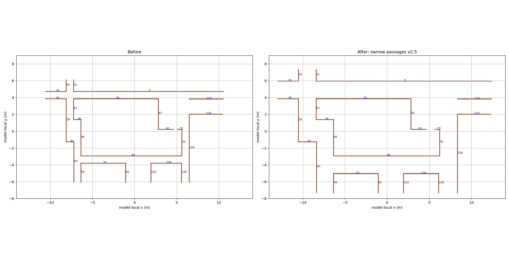

# 实验楼窄过道加宽（2026-10-14）

按用户截图，在当前默认 `gazebo_building_editor_models/shiyanlou/shiyanlou_third.world` 中，将同类窄过道和小门口的**净宽**改为修改前的 2.5 倍，不是将整栋建筑统一放大。

| 位置（墙段编号） | 修改前净宽 | 修改后净宽 |
| --- | ---: | ---: |
| 小门口 81 / 72 | 0.41333 m | 1.03332 m |
| 左上竖向 19 / 87、26 / 31 | 0.82367 m | 2.05918 m |
| 左下竖向 60 / 44、60 / 54 | 0.78800 m | 1.97000 m |
| 右侧竖向 116 / 70 | 0.82367 m | 2.05918 m |
| 右下竖向 116 / 130 | 0.87367 m | 2.18418 m |
| 上侧横向 5 / 91、33 / 35 | 0.82367 m | 2.05918 m |
| 下侧横向 48 / 52、48 / 126 | 0.82366 m | 2.05915 m |



为保持连接，相关墙段的位置、长度及 world 中保存的墙段 state 同步更新。保留 26 段墙、墙高 2.5 m、墙厚 0.05 m、朝向与高度；碰撞和视觉尺寸一致。地面、用户添加的 unit_box、机器人及传感器配置、出生位置未改。整体 XY 范围由约 21.16 × 12.24 m 变为 25.43 × 14.71 m；部分相连房间/分支随墙线调整。

本次 third 加宽未修改原始 `shiyanlou.world`；quarter 随后单独按自身原净宽加宽，见文末。third 修改前的场景保存在：

```text
gazebo_building_editor_models/shiyanlou/backups/shiyanlou_third.before-passage-widening-20261014.world
SHA-256: 312a2b6b75c4ae08bddce076483d88d0ade66eebb2053b92d9b2455445e5e4d7
```

检查：SDF 格式有效；上述 10 组走廊宽度和 1 个门口均为原净宽的 2.5 倍；碰撞矩形原有 18 组墙角连接保留，没有新增墙间相交；保存状态与新墙位姿一致。未进行新场景的闭环导航验证。

正在运行的 Gazebo 不会热更新：停止仿真、SLAM、遥控/导航，再按原命令启动：

```bash
cd ~/turtlebot3-fast-lio2
./turtlebot3_ws/start-world.sh 2d
```

**重新启动 SLAM 并建立新地图，不能继续沿用加宽前的地图或 SLAM 会话。** 不要在退出旧 Gazebo 时把旧世界再次保存覆盖到新文件上。当前安装使用 symlink-install，安装目录里的 world 与源码是同一文件，无需仅为此重编译。

## Quarter 单独加宽，随后从 2.5 倍回调到 2 倍

quarter 最初也按自身原净宽扩大 2.5 倍，随后用户要求“先除 2.5 再乘 2”。当前从 **quarter 加宽前备份**重新计算为原净宽的 **2 倍**，没有整体缩放建筑或累计叠加；third 保持原来的 2.5 倍设置。

| 位置 | Quarter 原净宽 | 之前 2.5 倍 | 当前 2 倍 |
| --- | ---: | ---: | ---: |
| 门口 81 / 72 | 0.31000 m | 0.77500 m | 0.62000 m |
| 左下竖向 60 / 44、60 / 54 | 0.59100 m | 1.47750 m | 1.18200 m |
| 左上、右上、上下横向等其余窄过道 | 约 0.61775 m | 约 1.54438 m | 约 1.23550 m |
| 右下竖向 116 / 130 | 0.65525 m | 1.63813 m | 1.31050 m |

当前总体约 18.00 × 10.42 m（加宽前 15.87 × 9.18 m，2.5 倍时 19.07 × 11.03 m）。保留 quarter 自身墙厚 **0.0375 m**、墙高 2.5 m、26 段墙和地面；同步视觉、碰撞及保存状态。10 组走廊和 1 个门口的净宽比例、18 组墙角连接及无新增墙间相交均检查通过，SDF 校验通过。保留了用户后来保存的 unit_box；再次保存进 world 的 burger 和机器人 state 已用 XML 注释禁用，只有 launch 生成运行时机器人。未进行新场景导航测试。

修改前备份：

```text
gazebo_building_editor_models/shiyanlou/backups/shiyanlou_quarter.before-passage-widening-20261014.world
SHA-256: b6924b5850771a496d4104bfd0ad734642194cbe44afe744c4b1c6cf5964dd54
```

回调前（包含用户新加的 unit_box 和保存机器人）的现场备份为 `backups/shiyanlou_quarter.passages-2.5x-20261014.world`，SHA-256 为 `e07438c20c6d7c944050eb59e1dd6a5b9004e9e97d5440fbfc5d8acf221f5db5`。不要直接覆盖恢复它来运行，因为其中含运行时机器人。

默认仍为 third；停止旧仿真与 SLAM 后，显式选择 quarter：

```bash
./turtlebot3_ws/start-world.sh 2d scene:=shiyanlou_quarter
```

需要为当前 2 倍净宽的 quarter 重新建图，不要沿用 2.5 倍 quarter 旧地图或 third 地图。本次未修改 third、原尺寸场景、机器人模型和启动默认值。
