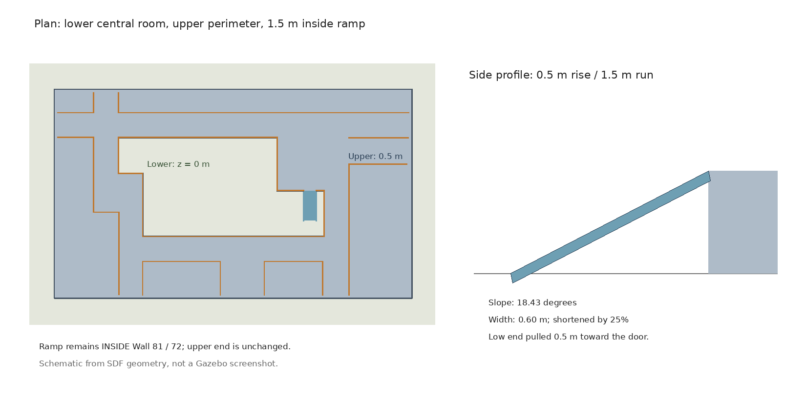

# 实验楼：中央区域低位、81/72 门内坡道与 0.5 m 外围平台

## 最新修正：坡道在门内，不是门外

按用户绿色标记，**中央大房间及其右下门内区域是低位区 z=0；门外及外围是上层 z=0.5 m**。坡道放在 81/72 小门的中央房间一侧，从房内低处沿 +Y 上到门口，再进入外围上层。旧版门外坡道和低位前庭已移除，不能继续使用旧图理解方向。

只修改 `gazebo_building_editor_models/shiyanlou/shiyanlou.world`；文件中的黄色墙体模型仍名为 `shiyanlou_quarter`。没有更改黄色墙体的 XY、朝向、尺寸、0.62 m 门宽或其整体抬高 0.5 m 的设置。third/origin/bak 场景和现有 PCD/二维地图均不修改。



## 地板与物体

- `shiyanlou_upper_floor` 改为六块实体地板，顶面 z=0.5，围绕中央房间铺设；所有黄色墙体脚下仍有支撑。
- 中央房间按其折线墙体轮廓留空，使用原 z=0 地面，不再以整板覆盖绿色区域。
- 原门外前庭和右侧通道现在均补齐 z=0.5 的地板。
- 上层边界有 0.25 m 矮挡边，除坡道高端外不留其他上下层通口。坡道两侧保留 0.15 m 挡边。
- 中央 `unit_box` 和保存的机器人恢复原低位高度，连同其保存状态一并修正。门外两个灰色柱体则抬高 0.5 m，放在新上层地板上。
- 地板、坡道及挡边均有视觉一致的碰撞体；地板和坡道摩擦系数为 1。

这是一高一低两个可通行标高，不是可在整栋建筑下面穿行的双层楼；上层地板使用实心平台。

## 坡道参数（世界坐标，米）

| 参数 | 当前值 |
| --- | --- |
| 高差 | 0.5 |
| 水平长度 | 1.5（从 2.0 缩短 25%） |
| 斜面长度 | 约 1.58114 |
| 通行宽度 | 约 0.60（原门口净宽约 0.62） |
| 坡度 | 约 18.43° |
| 低端顶面中心，位于绿色中央房间内 | `(3.522745, -3.0236, 0)` |
| 高端顶面中心，位于门口 | `(3.522745, -1.5236, 0.5)` |
| 上坡方向 | 世界坐标 +Y，朝向约 `yaw=1.570796` |

门内到南侧 Wall_48 的净深度不足最初的 3 m，门内版本曾采用 2 m。按用户最新截图进一步缩短为 1.5 m：门口高端固定，坡底向门口收回 0.5 m，低端到南墙的余量增加至约 0.825 m；其余场景不变。高差仍为 0.5 m，因此坡度由约 14.04° 增至 18.43°，机器人爬坡能力需要重新测试。坡道使用单块倾斜 box，其顶面低端与原地面齐平、高端与门外上层地板齐平；板体厚度向下布置，避免坡底台阶。

## 启动与出生高度

停止旧 Gazebo、建图和导航后，在仓库根目录运行：

```bash
./turtlebot3_ws/start-world.sh 3d scene:=shiyanlou
```

默认出生点 `(-2, 0.4)` 位于绿色中央低位区域，自动使用 `z=0.01`。

若想在坡底前方开始观察/遥控上坡：

```bash
./turtlebot3_ws/start-world.sh 3d scene:=shiyanlou \
  x_pose:=3.522745 y_pose:=-3.17 yaw_pose:=1.570796
```

若指定门外上层点 `(7.5, 0.5)`，则自动使用 `z=0.51`。`z_pose:=auto` 按实际地板/坡面计算出生高度，也可显式覆盖。

源 world 保留 Gazebo 保存的机器人；通过本项目 launch 启动时，临时过滤保存的 burger 及其 state，再生成所选模式的唯一机器人。源文件不会因该过滤而被覆盖，临时文件在 launch 退出时清理。

本机 world/launch 使用 symlink-install，无需重编译。必须关闭旧窗口后重新加载；不要从旧 Gazebo 保存覆盖新 world。

## 验证与边界

- 修正后的 SDF 校验、14 项 Python 回归检查及独立 Gazebo/ODE 支撑测试均通过。
- 检查覆盖：绿色区域为低位、原坡道侧已铺平、坡道位于门内且向 +Y 上升、两端齐平、墙体支撑、非坡口边界封闭、出生高度和运行时机器人去重。
- 独立物理测试验证中央地面、门外上层、原坡道位置和新坡面能提供正确支撑，不改变用户运行中的仿真。
- 尚未验证真实机器人模型能否稳定上下约 18.43° 的坡道，也未做闭环导航验收。
- 本次缩短前备份：`/tmp/tb3-shiyanlou-ramp-shorter.8RHbcU/`。此前方向修正前备份为 `/tmp/tb3-shiyanlou-ramp-side-fix.pfuwip/`；最初改造前备份仍在 `/tmp/tb3-shiyanlou-ramp.MCZBgA/`。

**旧地图不适用，需要重新建图。** 场景包含坡道和落差，原来限定平地的在线导航方案需要另外考虑坡面通行性、地面分离及落差检测。
